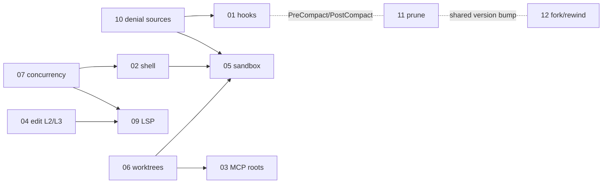

# Agent capability gaps — design set

Proposals for closing capability gaps between Diligent and other open coding-agent harnesses (codex, oh-my-pi,
hermes-agent, jcode). Each document records the current state with file/line evidence, the reference behavior, a
concrete design (config, protocol, types, lifecycle), risks, and tests. These are proposals: nothing here describes
shipped behavior. When an item ships, its user-facing behavior moves to `docs/guide/`.

Out of scope for this set: session storage location, directory layout, and session indexing.

| # | Document | Size | Ships in |
|---|---|---|---|
| 01 | [Lifecycle hooks](01-hooks.md) | M | Wave 2 |
| 02 | [Shell: streaming, background, PTY, process-group kill](02-shell-execution.md) | M | Waves 1–2 |
| 03 | [MCP elicitation, roots, sampling, tool list changes](03-mcp-client-capabilities.md) | M–L | Waves 2–3 |
| 04 | [Edit robustness](04-edit-robustness.md) | S → M | Waves 1–3 |
| 05 | [OS sandbox](05-sandbox.md) | L | Wave 4 |
| 06 | [Subagent worktree isolation](06-subagent-worktrees.md) | M | Wave 3 |
| 07 | [Per-call tool concurrency](07-tool-concurrency.md) | S–M | Wave 1 |
| 08 | [Knowledge extraction and consolidation](08-memory-consolidation.md) | S → L | Waves 1, 3 |
| 09 | [Language server integration](09-lsp.md) | L | Wave 3 |
| 10 | [Denial sources and breaker](10-denial-breaker.md) | S | Wave 1 |
| 11 | [LLM-free context pruning](11-compaction-pruning.md) | M | Wave 2 |
| 12 | [Thread rename, fork, rewind](12-session-fork-rename.md) | S → M | Waves 1–2 |

## Corrections to the initial gap list

Reading the code changed several premises of the original gap list:

- **Edit:** `apply_patch` already has tolerant matching (exact → trimEnd → trim → normalized punctuation,
  `tools/apply-patch.ts:529-575`). The gaps are in `edit`/`multi_edit` and in stale writes during approval waits
  (`tools/edit.ts:180-217`), which can overwrite concurrent changes.
- **Repeated denials:** a user rejection already ends the turn (`ctx.abort()` in every writing tool). The real defect
  is that a permission-rule `deny` is reported as `[Rejected by user]` and also ends the turn (`app-server/server.ts:
  668-674`). The breaker matters once hooks and the sandbox produce non-terminal denials.
- **Shell:** besides missing streaming/background/PTY, timeouts on POSIX kill only the shell PID and leave
  grandchildren running (`util/process.ts:19-25`).
- **MCP:** `tools/list_changed` is also unhandled; connections are a process-wide singleton, so server-initiated
  requests need routing to a thread before any UI work.
- **Concurrency:** code mode already has a FIFO reader/writer gate (`tools/code-mode/gate.ts`); the work is to use it
  in the main loop, not to invent one.
- **Knowledge:** `knowledge.nudgeInterval` is accepted by the schema and read nowhere.
- **Sessions:** the file format already stores an entry tree and a `session_info.name`; rename/fork/rewind are API and
  client work plus one new entry type, not a storage redesign.
- **Live tool output:** the shared reducer keeps one live-tool slot and appends `tool_update` deltas
  (`protocol/src/conversation-reducer.ts:68-94`); streaming and interleaved concurrency both need it keyed by item.

## Dependencies

## Waves

**Wave 1 — fixes and small, contained wins (no new protocol surface except rename)**

- 10: denial sources; policy denials stop ending the turn; breaker.
- 07: core gate, per-call scheduling, reducer live-slot keyed by item.
- 04 L1 + L2: tolerant `edit` matching (shared matcher with `apply_patch`), stale-write guard, atomic writes.
- 02: process-group kill; `tool_update` streaming for foreground `bash`.
- 12: `thread/name/set`.
- 08 M0: implement `nudgeInterval` as a sibling of the existing plan-reminder loop hook.

**Wave 2 — new extension surfaces**

- 01 phase A: `PreToolUse`, `PostToolUse`, `SessionStart`, `SubagentStart/Stop` — **blocked on decision 1**.
- 02: `yield_time_ms`, `bash_wait`, PTY on POSIX.
- 03: request routing, roots, `tools/list_changed`, form elicitation (protocol + both clients).
- 04 L3: read tracking in `warn` mode.
- 11: `prune` method (session version 13).
- 12: `thread/fork`, `thread/rewind` (same version bump as 11 when shipped together).

**Wave 3 — larger features behind configuration or experiments**

- 06: worktree isolation.
- 09: LSP tool and post-edit diagnostics.
- 03: sampling (opt-in per server), URL elicitation.
- 08 M1/M2: extraction and consolidation, default off.
- 04 L4: anchored edits as an experiment; 04 L3 to `enforce` if evals allow.
- 01 phase B.

**Wave 4**

- 05: sandbox on macOS/Linux; Windows backend designed separately.
- 01 phase C.

## Decisions

Decided:

| # | Decision | Outcome | Affects |
|---|---|---|---|
| 2 | Policy `deny` and the turn | Policy denials no longer end the turn; the model gets the rule and continues without the operation. `denialBreakerThreshold: 1` restores a near-hard stop | 10 |
| 5 | `knowledge.nudgeInterval` | Implement by reusing the plan-reminder hook pattern (doc 08 M0), not a new mechanism | 08 |

Deferred (must be decided before the dependent wave starts):

| # | Decision | Recommendation | Blocks |
|---|---|---|---|
| 1 | Trust model for project-layer config that executes commands (hooks, LSP servers) | Per-project trust prompt, remembered in global config by real path | 01 phase A, 09 (wave 2–3) |
| 3 | Session version bump timing for `context_prune` and `branch` entries | One bump (13) in the release that ships the first of 11/12 | 11, 12 fork/rewind |
| 4 | Windows scope for PTY and sandbox | Explicit "unsupported" errors in phase 1, no silent fallbacks | 02 PTY, 05 |
| 6 | Worktree baseline default | `working-tree` (`git stash create`), so children see the parent's uncommitted edits | 06 |
| 7 | `PreToolUse` default timeout | 5 s (current hook default is 10 s) | 01 |

Wave 1 does not depend on any deferred decision.

## Cross-cutting rules (from `AGENTS.md` / `ARCHITECTURE.md`)

- User-facing features go through the shared protocol and update both clients in this repository in the same change.
- Tests first; protocol-observable behavior in `packages/e2e/app-server/`, internals in the owning package's `test/`.
- `Config` for configuration values, `Options` for optional function arguments.
- Product- and organization-neutral content.
